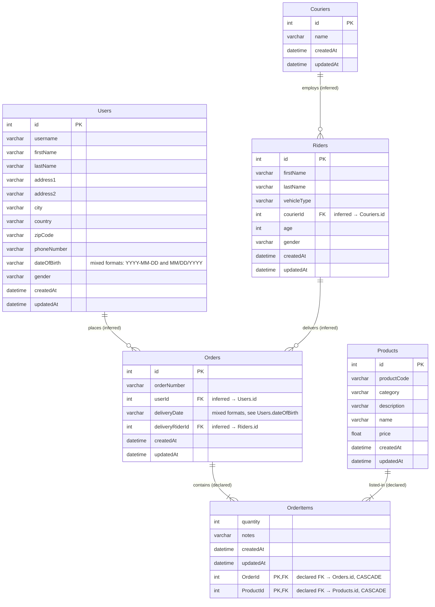

# Source Database Schema (MySQL dump → `source_db`)

Visual reference for the raw dumps in `db/raw-dumps/`. Documentation only —
the executable schema lives in `db/source/init/01_source_schema.sql`.

## Relationship inventory

| # | From → To | Via | Declared in dump? |
|---|-----------|-----|-------------------|
| 1 | Couriers → Riders | `Riders.courierId` | No — inferred |
| 2 | Users → Orders | `Orders.userId` | No — inferred |
| 3 | Riders → Orders | `Orders.deliveryRiderId` | No — inferred |
| 4 | Orders → OrderItems | `OrderItems.OrderId`, ON DELETE/UPDATE CASCADE | Yes |
| 5 | Products → OrderItems | `OrderItems.ProductId`, ON DELETE/UPDATE CASCADE | Yes |

Inferred edges will be promoted to enforced `FOREIGN KEY`s in
`01_source_schema.sql` so orphan rows fail fast at load time.

## Raw volume (measured)

| Table | Rows | Size |
|-------|------|------|
| Couriers | 3 | 4 KB |
| Riders | 100 | 12 KB |
| Users | ~100,000 | 19 MB |
| Products | ~10,000 | 1.8 MB |
| Orders | ~1,000,000 | 84 MB |
| OrderItems | ~2,000,000 | 124 MB |

## Known source-data issues → Phase 3 ETL checklist

| # | Issue | Evidence in dump | ETL action (`transform.py`) |
|---|-------|------------------|-----------------------------|
| 1 | Mixed date-string formats | `deliveryDate`: `'2025-05-24'` vs `'06/25/2025'` in `faker_Orders.sql`; `dateOfBirth` same faker pipeline (verify empirically) | Try `YYYY-MM-DD` then `MM/DD/YYYY` parse; reject/quarantine unparseable; load warehouse as `DATE` |
| 2 | `gender` value inconsistency | `Riders` and `Users`: `'M'`, `'F'`, `'Male'`, `'Female'` (Users: 24,943 / 25,094 / 24,757 / 25,206) | Normalize to single coding (`M`/`F`) in both dim tables; any other value rejects |
| 3 | `price` is approximate | `float` in MySQL → `REAL` in source; binary-float rounding | Cast to `NUMERIC(12,2)` in warehouse fact; never sum `REAL` directly |
| 4 | MySQL string escapes | `Emard\'s` in `faker_Products.sql` descriptions | Converter rewrites `\'`→`''` at import (545 descriptions carry an apostrophe, e.g. `Kreiger - Emard's`). Product names have none, and `DIM_PRODUCT` does not load descriptions, so the warehouse is unaffected |
| 5 | Bulk-identical timestamps | `createdAt`/`updatedAt` = `'2025-09-22 16:56:36'` across nearly all rows | Not meaningful event times — warehouse `dim_date` must derive from `deliveryDate`, not these |
| 6 | Undeclared FKs | `userId`, `deliveryRiderId`, `courierId` have no constraints in dump | Scaffold enforces them; import fails fast on orphans — resolve before ETL, not during |
| 7 | Vehicle spelling variants | `Riders.vehicleType`: `Bike` + `Bicycle`, `Motorbike` + `Motorcycle`, `Car`, `Trike` (6 labels) | Merge spelling variants: 4 vehicles (Bicycle 29, Motorcycle 42, Car 15, Trike 14) |
| 8 | Category spelling variants | `Products.category`: `TOYS`/`Toy`/`Toys`, `BAG`/`Bags`, `make up`/`Makeup`, `GADGETS`/`Gadgets` + 5 clean labels (14 labels) | Merge case/spacing/plural variants only: 9 categories; distinct concepts stay separate |
| 9 | Prices beyond centavos | MySQL `FLOAT` prices with up to 5 decimals (e.g. `1.77046`); 920 of 10,000 products | Round half-up to `NUMERIC(12,2)` from the text form; catalog total moves +PHP 0.42 (49,866,840.57 -> 49,866,840.99) |
