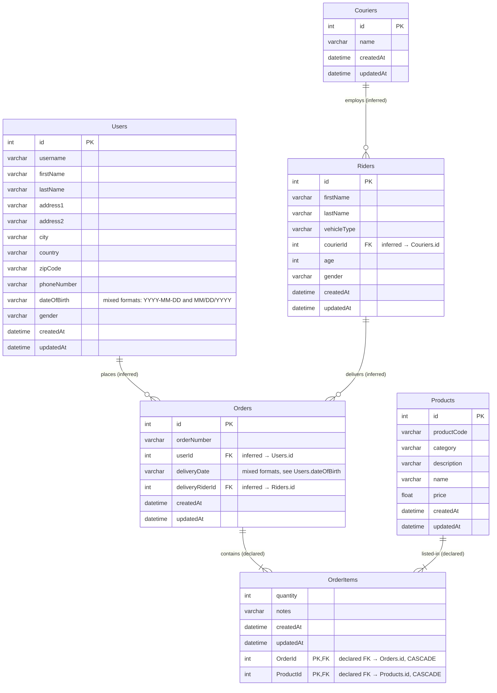

# Source Database Schema (MySQL dump → `source_db`)

Visual reference for the raw dumps in `db/raw-dumps/`. Documentation only —
the executable schema lives in `db/source/init/01_source_schema.sql`.

## Relationship inventory

| # | From → To | Via | Declared in dump? |
|---|-----------|-----|-------------------|
| 1 | Couriers → Riders | `Riders.courierId` | No — inferred |
| 2 | Users → Orders | `Orders.userId` | No — inferred |
| 3 | Riders → Orders | `Orders.deliveryRiderId` | No — inferred |
| 4 | Orders → OrderItems | `OrderItems.OrderId`, ON DELETE/UPDATE CASCADE | Yes |
| 5 | Products → OrderItems | `OrderItems.ProductId`, ON DELETE/UPDATE CASCADE | Yes |

Inferred edges will be promoted to enforced `FOREIGN KEY`s in
`01_source_schema.sql` so orphan rows fail fast at load time.

## Raw volume (measured)

| Table | Rows | Size |
|-------|------|------|
| Couriers | 3 | 4 KB |
| Riders | 100 | 12 KB |
| Users | ~100,000 | 19 MB |
| Products | ~10,000 | 1.8 MB |
| Orders | ~1,000,000 | 84 MB |
| OrderItems | ~2,000,000 | 124 MB |

## Source dataset content (business description)

Measured 2026-10-11 against live `source_db` (PostgreSQL 16, `localhost:5433`).
Archive: `MCO1_dataset_ecommerce.zip` (40.7 MB, SHA-256 `a10f1186…0387e862`),
six `Dump20250923/faker_*.sql` dumps. Synthetic faker e-commerce delivery
network — all names, addresses, and codes are random strings, not real PII.

### What each table means

| Table | Business meaning | Grain | Key facts (measured) |
|-------|------------------|-------|----------------------|
| Couriers | Logistics partners employing riders | One row per courier | 3 rows: `JNT`, `LBCD`, `FEDEZ`; 31/35/34 riders each |
| Riders | Delivery staff | One row per rider | 100 riders; age 18–60 (36 distinct); 6 raw vehicle labels, 4 gender codes (see vocabularies) |
| Users | Customers placing orders | One row per customer | 100,000; effectively single-age (DOB 2006-09-29–2007-09-28, 365 distinct days); ~10.0 orders/user (max 28) |
| Products | Saleable catalog | One row per product | 10,000; 14 raw categories (case/duplicates); price 1.77–9,999.42, avg ~4,986.68 |
| Orders | One delivery event | One row per order | 1,000,000; `deliveryDate` 2024-09-24–2025-09-23 (full year, ~84–85k/month); ~10,000 orders/rider (range 9,745–10,239); business time = `deliveryDate`, never `createdAt` |
| OrderItems | Products in an order | One row per (Order, Product); 1–4 lines/order, avg 2.0 | 1,999,824; `quantity` 1–10 uniform (~200k each); basket total 1–34, mean 11.0; `notes` always NULL |

Opaque identifiers: `orderNumber` (e.g. `uCjIujlhtS`), `username` (e.g. `FLDxwbCMvn`),
`productCode` (e.g. `FxevRZuIKT`) are 10-char random strings with no business meaning.

### Measured domain vocabularies

- **Vehicles (`Riders.vehicleType`):** `Motorbike` 26, `Bike` 17, `Motorcycle` 16,
  `Car` 15, `Trike` 14, `Bicycle` 12. ETL collapses synonyms
  (`Bike`→`Bicycle`, `Motorbike`→`Motorcycle`) to the 4 DW values
  `Bicycle / Motorcycle / Car / Trike`.
- **Gender:** Riders `F` 29 / `Male` 26 / `Female` 24 / `M` 21;
  Users `Female` 25,206 / `F` 25,094 / `M` 24,943 / `Male` 24,757.
  Normalize to `M`/`F` (Issue #2).
- **Product categories (14 raw, ~660–770 products each):**
  `TOYS` 770, `Clothes` 745, `GADGETS` 735, `Bags` 731, `Men's Apparel` 721,
  `make up` 719, `Electronics` 718, `BAG` 714, `Appliances` 712, `Toy` 711,
  `Toys` 691, `Laptops` 687, `Makeup` 685, `Gadgets` 661.
  Case/duplicates (`TOYS`/`Toys`/`Toy`, `GADGETS`/`Gadgets`, `make up`/`Makeup`,
  `Bags`/`BAG`) stay as-is in `DIM_PRODUCT`; product names are faker word-salad
  (e.g. `Incredible Metal Shirt`, `Tasty Wooden Fish`).
- **Geography (`Users`):** 249 countries, 60,400 cities, 89,318 zip codes,
  100,000 distinct `(country, city, zipCode)` combos — effectively one combo per
  customer. Top `(country, city)` pair has ≤4 users; top zip has 6 users.
  Distribution is uniform by construction, so Q20/Q21 drill-downs read flat.
  Faker mixes US-like cities with worldwide countries (e.g. `Chile / Nashua`).
- **Order-size mix (total `SUM(quantity)` per order):**
  Small (=1): 33,298; Medium (2–5): 169,923; Large (6–20): 723,472;
  Bulk (21+): 73,307. Feeds `DIM_ORDERSIZE` bands.
- **`notes`:** 0 of 1,999,824 non-null — free-text column is unused; ETL carries
  it as nullable with no analytic role.

### Synthetic-data character (why the DW has conditional questions)

- `createdAt`/`updatedAt` are bulk-load stamps (`Orders` spread over minutes on
  `2025-09-22 16:57–17:01`, not event times) — warehouse time derives only from
  `deliveryDate` (Issue #5).
- Customers are single-cohort (all DOB within one year) — `DIM_CUSTOMER.ageBand`
  dropped, Q22 answers concentration only.
- Geography, monthly demand (~84–85k/mo), orders/rider, and quantity (1–10
  uniform) are near-uniform — reported as findings, not data errors.
  See `data-warehouse-schema.md` Notes and Limitations.

## Known source-data issues → Phase 3 ETL checklist

| # | Issue | Evidence in dump | ETL action (`transform.py`) |
|---|-------|------------------|-----------------------------|
| 1 | Mixed date-string formats | `deliveryDate`: `'2025-05-24'` vs `'06/25/2025'` in `faker_Orders.sql`; `dateOfBirth` same faker pipeline (verify empirically) | Try `YYYY-MM-DD` then `MM/DD/YYYY` parse; reject/quarantine unparseable; load warehouse as `DATE` |
| 2 | `gender` value inconsistency | `Riders` and `Users`: `'M'`, `'F'`, `'Male'`, `'Female'` (Users: 24,943 / 25,094 / 24,757 / 25,206) | Normalize to single coding (`M`/`F`) in both dim tables; any other value rejects |
| 3 | `price` is approximate | `float` in MySQL → `REAL` in source; binary-float rounding | Cast to `NUMERIC(12,2)` in warehouse fact; never sum `REAL` directly |
| 4 | MySQL string escapes | `Emard\'s` in `faker_Products.sql` descriptions | Converter rewrites `\'`→`''` at import (545 descriptions carry an apostrophe, e.g. `Kreiger - Emard's`). Product names have none, and `DIM_PRODUCT` does not load descriptions, so the warehouse is unaffected |
| 5 | Compressed generation timestamps | `createdAt` repeats across bulk-generated batches; canonical measurements: `docs/technical-documentation/profiling.md` PRF-1 | Not meaningful event times — warehouse `DIM_DATE` derives from `deliveryDate` |
| 6 | Undeclared FKs | `userId`, `deliveryRiderId`, `courierId` have no constraints in dump | Scaffold enforces them; import fails fast on orphans — resolve before ETL, not during |
| 7 | Vehicle spelling variants | `Riders.vehicleType`: `Bike` + `Bicycle`, `Motorbike` + `Motorcycle`, `Car`, `Trike` (6 labels) | Merge spelling variants: 4 vehicles (Bicycle 29, Motorcycle 42, Car 15, Trike 14) |
| 8 | Category spelling variants | `Products.category`: `TOYS`/`Toy`/`Toys`, `BAG`/`Bags`, `make up`/`Makeup`, `GADGETS`/`Gadgets` + 5 clean labels (14 labels) | Merge case/spacing/plural variants only: 9 categories; distinct concepts stay separate |
| 9 | Prices beyond centavos | MySQL `FLOAT` prices with up to 5 decimals (e.g. `1.77046`); 920 of 10,000 products | Round half-up to `NUMERIC(12,2)` from the text form; catalog total moves +PHP 0.42 (49,866,840.57 -> 49,866,840.99) |
